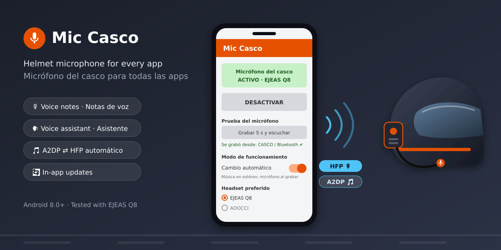

# 🎙️ Mic Casco

**[English](#english) · [Español](#español)**


---

## English

**Mic Casco** is a small Android app (interface in Spanish) that forces the phone to use the **Bluetooth helmet headset microphone** for *all* audio capture, not just phone calls.

Without it, many apps (WhatsApp voice notes, Google Assistant / Gemini, voice recorders) keep using the phone's built-in microphone even when a Bluetooth headset is connected. On a motorcycle, that means the app hears wind and engine noise instead of your voice.

### ✅ Tested with

| Item | Model |
|---|---|
| Phone | Xiaomi Redmi (HyperOS) |
| Helmet intercom | EJEAS Q8 |
| Motorcycle screen | AOOCCI (wireless Android Auto) |
| Android version | Android 8.0 or later required |

It should work with any Bluetooth headset that supports the hands-free profile (HFP), but it has only been tested with the devices listed above.

### ✨ Features

- Routes the microphone of every app to the Bluetooth headset.
- **Two operating modes** (toggle in the app):
  - **Always on** (default): the helmet microphone is active all the time. Most reliable; music plays in mono.
  - **Automatic switching**: music stays in **stereo** and the app switches to the helmet microphone only while another app is recording (WhatsApp voice notes, Google Assistant, etc.).
- **Quick Settings tile** ("Mic Casco") to turn it on and off without opening the app.
- **Automatic mode**: turns on when your chosen headset connects and turns off when it disconnects.
- **Microphone test**: records 5 seconds and plays them back, showing which microphone was used (helmet ✔ or phone ✘).
- **Built-in updater**: every time you open the app it checks GitHub for a new version and can install it over the current one.
- Does not interfere with regular phone calls.

### 📥 Installation

1. On your phone, open the latest release:
   **https://github.com/TI3WTI/MicCasco/releases/latest**
2. Download **MicCasco.apk**.
3. Open the file. Android will ask you to **allow installation from unknown sources** for your browser or file manager. Allow it.
4. **Google Play Protect** may warn you or block the app, because it is not published on Google Play. Tap **More details → Install anyway**.
   If that option does not appear: open **Play Store → profile picture → Play Protect → ⚙️**, temporarily turn off **Scan apps with Play Protect**, install the app, and turn it back on.
5. Open **Mic Casco** and grant the requested permissions (Nearby devices / Bluetooth, Notifications, Microphone for the test).

### 🏍️ How to use

1. Connect your helmet headset to the phone.
2. In **Headset preferido** (Preferred headset), select your intercom. If the intercom is paired with the motorcycle screen instead of the phone, select the screen.
3. Tap **ACTIVAR MICRÓFONO DEL CASCO** (activate helmet microphone), or use the Quick Settings tile.
4. In **Modo de funcionamiento** (operating mode), choose **Cambio automático** (automatic switching) ON or OFF. See [Operating modes](#-operating-modes).
5. Run **Grabar 5 s y escuchar** (record 5 s and listen). The result should say **"CASCO / Bluetooth ✔"**.
6. Recommended:
   - Enable **Activar solo al conectar este headset** (activate only when this headset connects) for hands-free operation.
   - Tap **Quitar optimización de batería** (remove battery optimization) so the system does not close the app while riding.

### 🎚️ Operating modes

A Bluetooth headset uses two different profiles, and only one can be active at a time:

| Profile | Used for | Audio |
|---|---|---|
| **A2DP** | Music | Stereo, high quality (AAC/SBC), **one-way only** (no microphone) |
| **HFP** (hands-free) | Calls | **Mono**, narrowband (8–16 kHz), **two-way** (with microphone) |

The headset microphone only exists in HFP, so Mic Casco has to switch the headset to HFP to use it.

| Mode | Behavior | Pros | Cons |
|---|---|---|---|
| **Always on** (switch OFF, default) | HFP all the time | Most reliable; the microphone is ready instantly | Music sounds mono and at lower quality |
| **Automatic switching** (switch ON) | A2DP while nobody records; HFP only while an app records, back to A2DP ≈2.5 s after recording stops | Music in stereo | The switch takes ≈1 s: wait a moment before speaking. May not work with every app or phone |

If one mode does not work well with your phone or apps, switch to the other one.

> The EJEAS Q8 uses Bluetooth 5.1 and **does not support Bluetooth LE Audio** (requires 5.2+), which is the only technology that allows stereo music and microphone at the same time.

### 🔄 Updates

Open the app and check the **Actualizaciones** (Updates) section. When a new version is available, tap **INSTALAR VERSIÓN N** (install version N). You can also tap **Buscar actualización** (check for updates). The app only checks when its screen is opened; it does not check in the background. The first time, Android will ask you to allow Mic Casco to install apps.

### ⚠️ Known limitations

- In **Always on** mode, audio to the helmet uses the voice channel (HFP), so **music sounds mono and at lower quality**. Use **Automatic switching** mode or turn the app off when you only want to listen to music.
- The **"Hey Google"** wake word is detected by a dedicated chip in the phone, so it still listens through the phone. Start the Assistant with the **headset button** or the **screen button**; after that, your command is heard through the helmet.
- Some manufacturers (Xiaomi, Samsung, etc.) aggressively close background apps. Remove battery optimization for Mic Casco.
- If WhatsApp shows *"You can't record voice messages during a call"*, open the app and uncheck **Mantener el canal del casco abierto** (keep the helmet channel open), or use Automatic switching mode.

### 🔐 Permissions used

| Permission | Why |
|---|---|
| Nearby devices / Bluetooth | Detect and select the helmet headset |
| Modify audio settings | Route the microphone to the headset |
| Notifications / Foreground service | Keep the routing active while riding |
| Microphone | Only for the 5-second test |
| Internet | Only to check for updates on GitHub |
| Install apps | Only to install updates you approve |

The app **does not collect, store, or send any personal data**. Audio recorded during the test stays in memory and is discarded after playback.

### 🛠️ Build from source

The APK is built automatically by **GitHub Actions** on every push to `main` and published under **Releases**. Changes to documentation (`.md` files) or to the workflow itself do not create a new version. To build manually: **Actions → Compilar APK → Run workflow**.

To build locally: open the project in **Android Studio** and press **Run**, or run:

```bash
gradle assembleDebug
```

### ⚖️ Disclaimer

This software is provided **"as is"**, without warranty of any kind. **Use it at your own risk.**
The author is not responsible for any damage, data loss, malfunction, missed calls, or any other consequence of using this app.
**Never handle your phone while riding.** Use voice commands and headset controls only, and always follow local traffic laws.

---

## Español

**Mic Casco** es una pequeña app para Android que obliga al teléfono a usar el **micrófono Bluetooth del casco** para *todo* lo que se graba, no solo para las llamadas.

Sin ella, muchas apps (notas de voz de WhatsApp, Asistente de Google / Gemini, grabadoras) siguen usando el micrófono del teléfono aunque haya un headset Bluetooth conectado. En la moto, eso significa que la app escucha el viento y el motor en lugar de su voz.

### ✅ Probado con

| Elemento | Modelo |
|---|---|
| Teléfono | Xiaomi Redmi (HyperOS) |
| Intercomunicador del casco | EJEAS Q8 |
| Pantalla de la moto | AOOCCI (Android Auto inalámbrico) |
| Versión de Android | Se requiere Android 8.0 o superior |

Debería funcionar con cualquier headset Bluetooth que soporte el perfil manos libres (HFP), pero solo se ha probado con los dispositivos indicados.

### ✨ Funciones

- Dirige el micrófono de todas las apps al headset Bluetooth.
- **Dos modos de funcionamiento** (interruptor en la app):
  - **Siempre activo** (de fábrica): el micrófono del casco queda activo todo el tiempo. Es el más confiable; la música se escucha en mono.
  - **Cambio automático**: la música sigue en **estéreo** y la app cambia al micrófono del casco solo mientras otra app graba (notas de voz de WhatsApp, Asistente de Google, etc.).
- **Botón en Ajustes rápidos** ("Mic Casco") para encender y apagar sin abrir la app.
- **Modo automático**: se enciende al conectar el headset elegido y se apaga al desconectarlo.
- **Prueba de micrófono**: graba 5 segundos y los reproduce, indicando qué micrófono se usó (casco ✔ o teléfono ✘).
- **Actualizador integrado**: cada vez que abre la app revisa GitHub y, si hay una versión nueva, puede instalarla sobre la actual.
- No interfiere con las llamadas telefónicas normales.

### 📥 Instalación

1. En el teléfono, abra la última versión publicada:
   **https://github.com/TI3WTI/MicCasco/releases/latest**
2. Descargue **MicCasco.apk**.
3. Abra el archivo. Android le pedirá **permitir la instalación de apps de fuentes desconocidas** para el navegador o el administrador de archivos. Permítalo.
4. **Google Play Protect** puede advertir o bloquear la app, porque no está publicada en Google Play. Toque **Más detalles → Instalar de todos modos**.
   Si esa opción no aparece: abra **Play Store → foto de perfil → Play Protect → ⚙️**, apague temporalmente **Analizar apps con Play Protect**, instale la app y vuelva a encenderlo.
5. Abra **Mic Casco** y conceda los permisos que solicita (Dispositivos cercanos / Bluetooth, Notificaciones y Micrófono para la prueba).

### 🏍️ Cómo se usa

1. Conecte el headset del casco al teléfono.
2. En **Headset preferido**, elija su intercomunicador. Si el intercomunicador está emparejado con la pantalla de la moto y no con el teléfono, elija la pantalla.
3. Toque **ACTIVAR MICRÓFONO DEL CASCO**, o use el botón de Ajustes rápidos.
4. En **Modo de funcionamiento**, encienda o apague **Cambio automático**. Vea [Modos de funcionamiento](#️-modos-de-funcionamiento).
5. Haga la prueba **Grabar 5 s y escuchar**. Debe aparecer **"CASCO / Bluetooth ✔"**.
6. Recomendado:
   - Marque **Activar solo al conectar este headset** para que funcione sin tocar nada.
   - Toque **Quitar optimización de batería** para que el sistema no cierre la app mientras conduce.

### 🎚️ Modos de funcionamiento

Un headset Bluetooth usa dos perfiles distintos, y solo uno puede estar activo a la vez:

| Perfil | Para qué | Audio |
|---|---|---|
| **A2DP** | Música | Estéreo, alta calidad (AAC/SBC), **solo de ida** (sin micrófono) |
| **HFP** (manos libres) | Llamadas | **Mono**, banda angosta (8–16 kHz), **de ida y vuelta** (con micrófono) |

El micrófono del headset solo existe en HFP, por eso Mic Casco tiene que cambiar el headset a HFP para usarlo.

| Modo | Comportamiento | Ventajas | Desventajas |
|---|---|---|---|
| **Siempre activo** (interruptor APAGADO, de fábrica) | HFP todo el tiempo | El más confiable; el micrófono está listo al instante | La música se escucha en mono y con menor calidad |
| **Cambio automático** (interruptor ENCENDIDO) | A2DP mientras nadie graba; HFP solo mientras una app graba, y vuelve a A2DP ≈2,5 s después | Música en estéreo | El cambio tarda ≈1 s: espere un instante antes de hablar. Puede no funcionar con todas las apps o teléfonos |

Si un modo no funciona bien con su teléfono o sus apps, cambie al otro.

> El EJEAS Q8 usa Bluetooth 5.1 y **no soporta Bluetooth LE Audio** (requiere 5.2 o superior), que es la única tecnología que permite música estéreo y micrófono al mismo tiempo.

### 🔄 Actualizaciones

Abra la app y revise la sección **Actualizaciones**. Cuando haya una versión nueva, toque **INSTALAR VERSIÓN N**. También puede tocar **Buscar actualización**. La app solo revisa cuando se abre su pantalla; no revisa en segundo plano. La primera vez, Android le pedirá permitir que Mic Casco instale apps.

### ⚠️ Limitaciones conocidas

- En modo **Siempre activo**, el audio del casco va por el canal de voz (HFP), así que **la música se escucha en mono y con menor calidad**. Use el modo **Cambio automático** o desactive la app cuando solo quiera escuchar música.
- La palabra **"Ok Google"** la detecta un chip dedicado del teléfono, por lo que sigue escuchándose por el teléfono. Abra el Asistente con el **botón del headset** o el **botón de la pantalla**; a partir de ahí, la orden se escucha por el casco.
- Algunos fabricantes (Xiaomi, Samsung, etc.) cierran apps en segundo plano. Quite la optimización de batería a Mic Casco.
- Si WhatsApp muestra *"No se pueden grabar mensajes de voz durante una llamada"*, abra la app y desmarque **Mantener el canal del casco abierto**, o use el modo Cambio automático.

### 🔐 Permisos que usa

| Permiso | Para qué |
|---|---|
| Dispositivos cercanos / Bluetooth | Detectar y elegir el headset del casco |
| Modificar ajustes de audio | Dirigir el micrófono al headset |
| Notificaciones / Servicio en primer plano | Mantener la función activa mientras conduce |
| Micrófono | Solo para la prueba de 5 segundos |
| Internet | Solo para buscar actualizaciones en GitHub |
| Instalar apps | Solo para instalar actualizaciones que usted apruebe |

La app **no recopila, guarda ni envía datos personales**. El audio de la prueba queda en memoria y se descarta después de reproducirlo.

### 🛠️ Compilar desde el código

El APK se compila automáticamente con **GitHub Actions** en cada cambio a `main` y se publica en **Releases**. Los cambios a la documentación (archivos `.md`) o al propio archivo de Actions no generan versión nueva. Para compilar a mano: **Actions → Compilar APK → Run workflow**.

Para compilar en su PC: abra el proyecto en **Android Studio** y presione **Run**, o ejecute:

```bash
gradle assembleDebug
```

### ⚖️ Aviso legal

Este software se entrega **"tal cual"**, sin garantía de ningún tipo. **Úselo bajo su propio riesgo.**
El autor no se hace responsable de daños, pérdida de datos, fallos, llamadas perdidas ni de ninguna otra consecuencia derivada de su uso.
**Nunca manipule el teléfono mientras conduce.** Use solo comandos de voz y los controles del headset, y respete siempre las leyes de tránsito.
